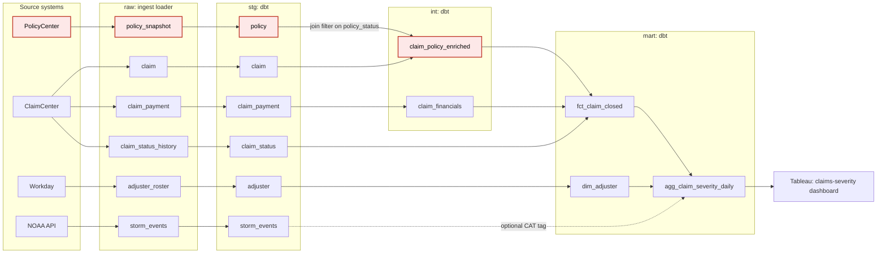

# CST_660_Week6
Root Cause, Value Stream, and Cost Drivers at Brightline Insurance

> **Bottom line.** On 2026-10-16 the claims-severity dashboard showed a 38% drop in closed claims
> two hours before adjuster staffing decisions. **Closures had not fallen:** ClaimCenter recorded
> 984 closures against a normal Friday of 994. A PolicyCenter column rename silently broke a join
> filter in the warehouse, and the Homeowners and Commercial Property claims dropped out. Every
> pipeline job reported `success`. This class of incident costs about **$48k per occurrence and
> $192k per year** (base estimate), almost all of it from decisions made on wrong data. Compute
> cost is negligible. The first fix is a **pre-publish quality gate** that pays back in under a
> month. The second is a **source data contract** with PolicyCenter.

## Contents

1. [Scenario](#1-scenario)
2. [What happened: timeline](#2-what-happened-timeline)
3. [Investigation: symptoms vs. causes](#3-investigation-symptoms-vs-causes)
4. [Root cause](#4-root-cause)
5. [Value stream and bottlenecks](#5-value-stream-and-bottlenecks)
6. [Cost drivers](#6-cost-drivers)
7. [Countermeasures](#7-countermeasures)
8. [Artifacts and how to reproduce](#8-artifacts-and-how-to-reproduce)
9. [Assumptions and limits](#9-assumptions-and-limits)

---

## 1. Scenario

Brightline Insurance is a regional property and casualty carrier. At **06:40 CDT on Friday
2026-10-16**, the VP of Claims Operations reports that the daily claims-severity dashboard shows a
**38% drop in closed claims**. Adjuster staffing decisions will be made from it at **08:40**.
Three teams already blame each other:

| Team | Their position |
|---|---|
| **Policy Platform** (PolicyCenter) | "We only renamed a column, and the loader handles schema drift." |
| **Data Engineering** (ingest + dbt) | "Every job succeeded. The only red alert is the weather feed." |
| **Claims Analytics** (marts + Tableau) | "Our dashboard logic didn't break this. Maybe it's a real decline." |

The work in this repo has four parts:
1. Build realistic observability telemetry with the cause buried in it.
2. Investigate the incident from the evidence alone.
3. Map the delivery value stream.
4. Put dollar figures on the incident class and prioritize fixes.

### The pipeline



*Red nodes are where the incident's causal chain runs. The dashed edge is the weather feed, which
only adds a tag but still delays the aggregate when it is late.*

| Layer | Tables | Owner |
|---|---|---|
| Source | PolicyCenter `policy`; ClaimCenter `claim`, `claim_payment`, `claim_status_history`; Workday `adjuster_roster`; NOAA `storm_events` | Policy Platform, Claims Systems, HR Systems, external |
| raw | One table per source, loaded by the ingest loader with "schema drift: allow" | Data Engineering |
| stg | Cleaned, renamed copies of each raw table | Data Engineering |
| int | `claim_policy_enriched` (claims joined to policies), `claim_financials` (payments per claim) | Data Engineering |
| mart | `fct_claim_closed` (incremental), `dim_adjuster`, `agg_claim_severity_daily` | Claims Analytics |
| Exposure | Tableau claims-severity dashboard | Claims Analytics |

The lineage graph has 24 nodes across these 6 layers, run nightly by `claims_nightly`. The source
extract cuts off at about 01:55, and the dashboard extract is scheduled for 05:30.

---

## 2. What happened: timeline

All times are CDT. **Bold** rows are the causal chain; the others are noise or red herrings.

| When | Event |
|---|---|
| 10-14 20:30 | ClaimCenter adds a `litigation_flag` column *(red herring)* |
| 10-15 16:20 | Claims Analytics merges PR #812, which adds a `cat_event_id` column and a CAT filter to the dashboard *(red herring)* |
| **10-15 21:47** | **PolicyCenter release CHG-48213 moves Homeowners (HO) and Commercial Property (CP) to extract API v4, renaming `pol_status_cd` → `policy_status_code`. Declared non-breaking.** |
| 10-16 02:01 | NOAA storm-events API returns HTTP 503; retries at 03:31 and 04:46 also fail *(red herring)* |
| **10-16 02:14** | **Ingest loader logs only `ADD_COLUMN policy_status_code`. The old column is kept and is now NULL for 36.6% of policies.** |
| **10-16 02:20** | **`stg.policy.policy_status` null rate jumps from 0.04% to 36.6%. Job status: success.** |
| **10-16 02:32** | **`int.claim_policy_enriched` loses 38% of its rows (369,835 → 229,113). Job status: success.** |
| **10-16 02:38** | **`mart.fct_claim_closed` appends 620 closures for the day, on time.** |
| 10-16 06:00 | NOAA feed finally loads, 2 hours late. The severity aggregate and dashboard wait on it and refresh at 06:06 and 06:11 |
| 10-16 06:40 | VP reports the 38% drop |

The bad data was in the warehouse **4 h 08 m before anyone noticed**, and every signal needed to
catch it was already in the telemetry.

---

## 3. Investigation: symptoms vs. causes

### Symptoms (what people saw)

- **Total closed claims** fell 37.6% (620 vs. a 994 average for the prior four Fridays).
- **Mean paid severity** fell 28.5% ($11,647 → $8,331). It looked like good news, but it was the same defect.
- **By line of business:** HO fell to 5% of normal and CP to 0%. Personal Auto, Commercial Auto, General Liability and Inland Marine all stayed within normal ranges.
- **Dashboard timing:** it refreshed late, and the severity aggregate wrote 5 line-of-business rows instead of 6.
- **Job status:** every job reported success.

The breakdown by line of business was the key clue. A real slowdown affects every line a little;
two lines going to zero while four stay normal points to a data defect.

### Candidate causes and verdicts

| Hypothesis | Verdict | Deciding evidence |
|---|---|---|
| Real business decline | Ruled out | ClaimCenter `CLOSED` events were normal (984); the pipeline delivered only 63% of them |
| Late or stale data (NOAA outage) | Ruled out | Nothing upstream of `fct_claim_closed` was late. It already had 620 rows at 02:38, and the storm feed only adds a tag through a LEFT JOIN |
| Failed job | Ruled out | Everything ended in `success`. This was a silent logic failure |
| Claims Analytics PR #812 | Ruled out | The row loss happens two layers upstream of the model that PR changed |
| ClaimCenter `litigation_flag` | Ruled out | Claim volumes and line-of-business mix were normal; the column is never used to join or filter |
| **PolicyCenter column rename** | **Root cause** | See below |

### What each signal showed

- **Row volume:** the first abnormal table in lineage order is `int.claim_policy_enriched`, down 38%, when its day-to-day change normally varies by only 0.13 percentage points (one standard deviation). Both of its inputs were normal.
- **Column profiles:** the first column with abnormal values is `raw.policy_snapshot.pol_status_cd`, at 36.6% NULL, alongside a new `policy_status_code` populated on 36.6% of rows. The values had moved to a new column name.
- **Schema change log:** the rename landed about 4 hours before the bad run, and the loader recorded it only as an added column.
- **Column-level lineage:** `pol_status_cd` → `stg.policy.policy_status` → used as a **join filter** in `int.claim_policy_enriched`.
- **Reconciliation:** the expected loss (HO 96% + CP 100%) is 38.2%; the observed loss is 38.0%. No second cause is needed.

---

## 4. Root cause

**A PolicyCenter column rename broke the claim-to-policy join filter. The result was a partial
load that looked like a business decline.**

```
PolicyCenter API v4 (HO, CP)   pol_status_cd ──renamed──▶ policy_status_code
raw.policy_snapshot            loader "schema drift: allow" adds the new column; old one goes NULL
stg.policy                     policy_status := pol_status_cd  (still reads the old name)
int.claim_policy_enriched      INNER JOIN … AND policy_status IN ('IF','CX','EX')
                               NULL IN (…) → row dropped. HO 96%, CP 100% of claims lost
mart.fct_claim_closed          incremental: history intact, only today is short
dashboard                      "38% drop in closures"
```

### Why nothing caught it

These are contributing factors. No single team is at fault.

1. The rename was declared non-breaking because the loader "handles drift." The loader only handles *added* columns.
2. There is no data contract, so Policy Platform couldn't see that `pol_status_cd` was used downstream.
3. An `INNER JOIN` with an `IN` filter on a nullable column drops rows without raising an error.
4. Monitoring covered freshness and job status only. There were no volume, null-rate or source-reconciliation checks.
5. The only red alert (NOAA) pointed the wrong way.
6. Because the fact table is incremental, the defect looked like a one-day business shock.

### Immediate fix

1. Patch `stg.policy` to `coalesce(policy_status_code, pol_status_cd)`.
2. Rebuild the intermediate table, reprocess the 10-16 partition, and refresh the dashboard.
3. Reconcile against the 984 closures recorded in ClaimCenter.
4. Tell Claims Ops not to staff from the 620 figure.

Full write-up: [`incident/INC-20261016_investigation.md`](incident/INC-20261016_investigation.md)

---

## 5. Value stream and bottlenecks

The map follows one day's closed-claims figure from the source systems to the staffing decision.
Times are medians over 90 normal nightly runs, along the slowest path through the pipeline.


| Stage | Wait before | Process time | % complete and accurate |
|---|---:|---:|---:|
| Ingest | 4 m | 14 m | 97.8% |
| Stage | 1 m | 6 m | 96.7% |
| Enrich | 1 m | 11 m | 97.8% |
| Model | 1 m | 5 m | 98.9% |
| Aggregate | 1 m | 2 m | 98.9% |
| **Publish** | **2 h 45 m** | 4 m | 98.9% |

Process cycle efficiency (PCE) is the share of lead time spent actually processing.

- **Source cutoff → dashboard:** 3 h 37 m lead time, 42 m of processing, **PCE 19.5%**.
- **Source cutoff → staffing decision:** 6 h 43 m, PCE 10%.

### Rework loops

- **R1:** the NOAA API failed three times on 10-16 and succeeded on the fourth attempt, 3 h 57 m after the first.
- **R2:** a warehouse timeout forced a rerun (09-03), adding 33 m. The schedule buffer absorbed it.
- **R3:** the defect escaped to the consumer (10-16). It was found by a person 4 h 08 m after it was produced, and the rebuild needs 28 m of compute plus diagnosis. **This is the only loop that reached the customer.**

### The two largest bottlenecks

- **B1, publishing on a fixed schedule:** data is ready at about 02:45, but the dashboard waits for 05:30. That is **76% of lead time, every day.** The wait works as a buffer for late loads, but it is paid daily to cover rare events. Because the aggregate also waits on the optional weather feed, the NOAA outage made the dashboard miss its deadline.
- **B2, defects found by the consumer instead of the pipeline:** no gate checks row loss, null rates or reconciliation before publishing. The defect was in the telemetry at 02:32 and found at 06:40, leaving about 2 hours to fix it before the decision.

The 13-hour wait while the day's closures accumulate is the largest wait, but it isn't ranked as a
bottleneck: the decision needs a full day of closures.

Full write-up: [`value_stream/VALUE_STREAM_MAP.md`](value_stream/VALUE_STREAM_MAP.md)

---

## 6. Cost drivers

The incident class is a silent upstream schema change that causes a partial load. Costs are in
USD per incident; the *high* column stacks every worst case, so it is not a likely outcome.

| Category | Low | Base | High | Share of base |
|---|---:|---:|---:|---:|
| Compute (wasted build, rebuild, ad hoc queries) | 23 | 70 | 179 | 0.1% |
| Rework (response, postmortem, analysts re-checking the dashboard afterwards) | 2,540 | 5,250 | 11,940 | 11% |
| Business impact (re-planning, claim delays, overtime catch-up) | 2,870 | 42,634 | 495,766 | 89% |
| **Total per incident** | **5,433** | **47,954** | **507,885** | |
| **Annual** (1 / 4 / 9 incidents per year) | **5,433** | **191,816** | **4,570,968** | |

### Key takeaways

- **Compute isn't a cost driver.** It is at most 0.4% of the total, and a base rebuild costs about $17.
- **The cost comes from deciding on wrong data.** Under-staffing (claim delays plus overtime) is 86% of the base total.
- **10-16 itself cost about $6.5k**, because the VP caught it before the decision. The other ~$41k is exposure that comes back every time nobody notices in time.
- **The biggest uncertainties are how long a wrong number survives and how often one is created:** days mis-staffed, renames per year, and the chance someone acts on the bad number.

Full write-up: [`cost_driver/COST_DRIVERS.md`](cost_driver/COST_DRIVERS.md)

---

## 7. Countermeasures

| Priority | Countermeasure | Build / run per year | Annual savings (base) | Payback |
|---|---|---|---:|---:|
| **1** | **Pre-publish quality gate + publish when data is ready** | $8.0k / $5.2k | **$174.7k** | **0.6 months** |
| **2** | **Source data contract + rename detection at ingest** | $12.0k / $5.6k | $153.5k | 1.0 month |

### #1, the quality gate

Block the publish on any of: join row-loss above 1%, unusual volume on full-rebuild tables, a
null `policy_status`, or a closed-claims count more than 2% off ClaimCenter. Publish when the
aggregate succeeds, with 05:30 as a deadline. Stop the dashboard waiting on the weather feed. If
the gate blocks, show the prior day's figure with a "data held" banner.

- **Why first:** it has the biggest savings and the fastest delivery (2–3 weeks, mostly one team). It catches any silent partial load, not only renames, and it removes both bottlenecks.
- **Effect on 10-16:** the defect would have been caught at about 02:35, with roughly 6 hours to fix it.

### #2, the data contract

List the PolicyCenter columns used downstream (taken from the lineage graph). PolicyCenter's
release checks fail if a listed column is renamed or dropped without a transition period. The
loader flags "new column plus a sibling column going NULL" as a probable rename and blocks
downstream builds.

- **Why second:** it is the only fix that reduces how often incidents happen, but it takes 6–8 weeks across teams.
- **Marginal value on top of #1:** about +$13.7k a year against $17.6k in first-year cost, so it pays from year 2.
- **Why do it anyway:** with the gate alone, the incident still happens and the decision runs on yesterday's data. It also protects every other PolicyCenter consumer, and it adds about $214k a year in the high case.

**If incidents are only about once a year (low case)**, neither fix pays back in year 1. The gate
needs about 3 incidents a year at low unit costs. Defer #2 and re-check frequency after two more
quarters.

---

## 8. Artifacts and how to reproduce

| Folder | Branch it was built on | Contents |
|---|---|---|
| [`synthetic/`](synthetic/) | `synthetic` | `generate_telemetry.py` (seeded, deterministic generator) and a data dictionary |
| [`data/telemetry/`](data/telemetry/) | `synthetic` | 91 nightly runs: table freshness, row volume by run, schema-change log, column profiles, lineage graph (JSON, GraphML, column-level CSV), dashboard data |
| [`incident/`](incident/) | `incident` | Investigation write-up + `investigate.py`, which recomputes every piece of evidence |
| [`value_stream/`](value_stream/) | `value_stream` | Value stream map (SVG), write-up, `vsm.py`, stage and rework-loop CSVs |
| [`cost_driver/`](cost_driver/) | `cost_driver` | Cost write-up, `cost_model.py`, cost and countermeasure CSVs, sensitivity, assumptions |

Each analysis script reads only `data/telemetry/` (and earlier stages' outputs). None of them reads
the generator, so the root cause is derived from evidence, not looked up.

```powershell
python -m venv .venv
.venv\Scripts\pip install -r requirements.txt     # numpy, pandas, networkx, matplotlib

.venv\Scripts\python synthetic\generate_telemetry.py   # regenerate telemetry (seed 660)
.venv\Scripts\python incident\investigate.py           # evidence for the investigation
.venv\Scripts\python value_stream\vsm.py               # value stream metrics + map
.venv\Scripts\python cost_driver\cost_model.py         # cost drivers + countermeasures
```

> **Instructors:** the answer key is in the module docstring of `synthetic/generate_telemetry.py`.
> Don't hand that file to anyone working the incident as an exercise.

---

## 9. Assumptions and limits

- **All data is synthetic.** Brightline, its systems and every figure are fictional. They were built to be realistic, including noise and red herrings: a hail-driven surge in late August, Labor Day, a late source load on 08-29, a warehouse timeout on 09-03, and an earlier harmless rename.
- **Not in the telemetry:** claim-close timestamps (the 13-hour accrual wait assumes closures centre around 13:00), and the 06:40 review and 08:40 decision times, which come from the scenario.
- **Most dollar inputs are assumptions**, with low, base and high values listed in [`cost_driver/assumptions.csv`](cost_driver/assumptions.csv). The measured inputs are compute minutes, missing claims, detection latency, adjuster headcount and closures per adjuster.
- **The frequency estimate is thin:** 2 renames in 90 days, one of which hit a used column. It drives a large share of the annual figure.
- **Not costed:** reserving and pricing contamination from the false severity drop, regulatory prompt-payment exposure, and policyholder retention. All of these would raise the business-impact share without changing the priority order.
- **Future-state numbers are projections** from measured medians, not observed results. Re-run `vsm.py` and `cost_model.py` on new telemetry after the countermeasures ship.
