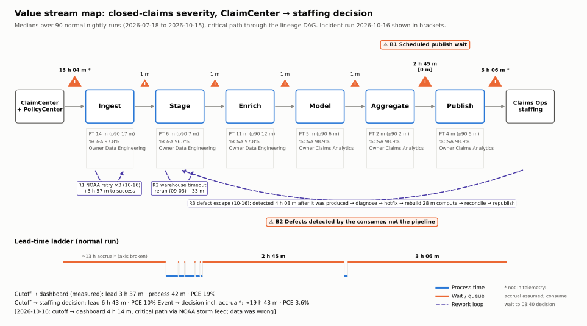

# Value stream map: claims-severity analytics delivery

**Value delivered:** an accurate count of the previous day's closed claims, with paid severity by
line of business, available for Claims Operations' morning adjuster-staffing decision.

**Scope:** one day's figure, from ClaimCenter/PolicyCenter through the nightly `claims_nightly`
pipeline to the 08:40 staffing decision. Measurements are medians over the 90 normal nightly
runs (2026-07-18 to 2026-10-15). The incident run on 2026-10-16 is reported separately. Each
stage is timed along the *critical path*: walking back from the dashboard through the lineage
graph and taking the input that finished last.

Everything here is reproduced by `python value_stream/vsm.py`, which reads only
`data/telemetry/`. Its outputs are `vsm_stage_metrics.csv`, `vsm_rework_loops.csv` and `vsm.svg`.

## 1. Stages: lead time and process time

PT is process time (the task actually running). Wait is the queue time before the stage starts.
%C&A is the share of the 91 runs where every table in the stage finished first time, on time, and
without a volume anomaly.

| # | Stage | Tables on critical path | Owner | Wait before | PT (median / p90) | %C&A |
|---|---|---|---|---|---|---|
| 0 | Business events accrue in source | ClaimCenter, PolicyCenter | Claims / Policy Platform | ≈ 13 h 00 m **assumed** | n/a | n/a |
| 1 | **Ingest** | `raw.policy_snapshot` (usually), `raw.claim`, `raw.claim_payment` | Data Engineering | 4.0 m after the 01:55 cutoff | 14.2 / 16.9 m | 97.8% |
| 2 | **Stage** | `stg.policy`, `stg.claim`, `stg.claim_payment` | Data Engineering | 1.3 m | 6.0 / 7.3 m | 96.7% |
| 3 | **Enrich** | `int.claim_policy_enriched`, `int.claim_financials` | Data Engineering | 1.2 m | 10.8 / 12.4 m | 97.8% |
| 4 | **Model** | `mart.fct_claim_closed` | Claims Analytics | 1.2 m | 5.0 / 5.9 m | 98.9% |
| 5 | **Aggregate** | `mart.agg_claim_severity_daily` | Claims Analytics | 1.1 m | 2.1 / 2.5 m | 98.9% |
| 6 | **Publish** | `bi.claims_severity_dashboard` (scheduled 05:30) | Claims Analytics | **165.4 m** (p90 169.5) | 4.0 / 4.8 m | 98.9% |
| 7 | Consume and decide | VP review ≈06:40, staffing decision 08:40 | Claims Ops | 3 h 06 m **scenario-reported** | not measured | n/a |

### Summary metrics

| Span | Lead time | Process time | Process cycle efficiency (PCE) |
|---|---|---|---|
| Source cutoff → dashboard (measured) | **3 h 37 m** (p90 3 h 38 m) | **42 m** | **19.5%** |
| Source cutoff → staffing decision | 6 h 43 m | 42 m | 10% |
| Business event → decision (includes assumed accrual) | ≈ 19 h 43 m | 42 m | ≈ 3.6% |
| Incident run 10-16, cutoff → dashboard | 4 h 14 m | n/a (critical path ran through the NOAA storm feed) | n/a, and the data was wrong |

Runs where every stage finished first time (rolled first-pass yield): **88 of 91 (96.7%)**.
The three exceptions were 08-29, 09-03 and 10-16.

**Not in telemetry.** Claim-close event timestamps aren't captured, so the accrual wait assumes
closures are centred around 13:00 on the prior day. The consume and decide times (06:40, 08:40)
come from the incident report, so they're observed for 10-16 only. Neither assumption affects
the measured cutoff-to-dashboard span.

## 2. Wait states

| Wait | Size | Measured? | What causes it |
|---|---|---|---|
| Accrual until nightly cutoff | ≈ 13 h | Assumed | Daily batch cadence. The decision consumes a full day of closures, so this wait is **required by the decision**, not waste (see section 4) |
| **Aggregate done → publish** | **2 h 45 m** | Yes (165.4 m median) | Dashboard extract runs on a **fixed 05:30 schedule**, not when its data is ready. 76% of cutoff-to-dashboard lead time |
| Publish → staffing decision | 3 h 06 m | Scenario-reported | Business buffer before the 08:40 decision. On 10-16 it was the only window to catch the defect, and it was spent finding it by hand |
| Inter-task queues (cutoff → ingest, between layers) | 1–4 m each, ≈ 9 m total | Yes | Orchestrator scheduling slots. Not material |
| Late-source wait (08-29, `raw.claim`) | +47.5 m | Yes | ClaimCenter maintenance window. Absorbed by the 05:30 buffer |

## 3. Rework loops

Each loop is detected from the telemetry and listed in `vsm_rework_loops.csv`.

| Loop | When | Stage | What was redone | Cost | Reached the customer? |
|---|---|---|---|---|---|
| **R1** NOAA API retry | 10-16 | Ingest (`raw.storm_events`) | 3 failed attempts (HTTP 503), succeeded on the 4th | +3 h 57 m to success. Dashboard published 06:11 instead of ~05:34 (11.5 m past SLA) | Late only |
| **R2** Warehouse timeout rerun | 09-03 | Stage (`stg.claim_payment`) | 30 m statement timeout, then a rerun | +33 m. Aggregate finished at 03:04 and was absorbed by the 05:30 buffer | No |
| **R3** Defect escape | 10-16 | Enrich (`int.claim_policy_enriched`) | 5 tables built "successfully" on bad data (23.6 m of wasted process time), then detected by a person | **Detected 4 h 08 m after the defect was produced** (02:32 → 06:40). Rebuild requires stg.policy → int → fct (partition) → agg → dashboard, **28 m of compute**, plus diagnosis and hotfix time that isn't in telemetry | **Yes. Decision-grade data was wrong** |

R1 and R2 are handled by the pipeline (retries, reruns). R3 is the only loop that crosses back
over the customer boundary, and it is the only one with no automated trigger: the loop starts
when a VP notices a number looks odd.

## 4. The two largest bottlenecks

### B1: Schedule-gated publish (2 h 45 m wait every day)

- **Evidence:** the aggregate finishes at a median of 02:45. The dashboard extract doesn't start
  until 05:30, so the data sits ready for 165.4 m (p90 169.5 m) on every normal run. This is
  **76% of the measured lead time** while process time is only 42 m, which is why in-pipeline
  PCE is just 19.5%.
- **Why it exists:** it is a time buffer. It absorbed the 08-29 late source (aggregate done at
  04:14) and the 09-03 timeout rerun (03:04) without the dashboard being late. The buffer works,
  but it is paid for every day to cover rare events.
- **How it amplified 10-16:** the aggregate has a hard dependency on the optional storm feed
  (only `cat_event_id`, through a LEFT JOIN). It couldn't start until NOAA recovered at 06:00, which
  pushed publish past SLA. Meanwhile the defective data had been sitting ready since 02:38.
- **Fix:** publish when the data is ready (dataset-triggered on aggregate success), keeping 05:30 as
  a latest-allowed deadline rather than a start time. Make the storm feed non-blocking: publish with
  `cat_event_id` NULL and backfill the tag later. The dashboard would be ready at ~02:50, and the
  165 m buffer moves to the consumer side, where it can be used (see B2).

### B2: Defects are found by the consumer, not the pipeline (4 h 08 m detection plus rework)

- **Evidence:** on 10-16 every task reported `success`. The volume anomaly in
  `int.claim_policy_enriched` (-38%, z ≈ -306) and the null-rate jump in `stg.policy.policy_status`
  (0.04% → 36.6%) were in the telemetry by 02:32. Nobody acted on them until the VP called at 06:40.
  Detection latency was 4 h 08 m, and the repair (diagnose, hotfix, rebuild five tables,
  reconcile, republish) had to fit inside the 2 h before the 08:40 decision.
- **Why it's a bottleneck despite being rare:** %C&A is 97–99% per stage, but the one escape
  invalidated the stream's only output on a decision day. It also triggered work across three
  teams. The *cost of delay* is the staffing decision itself, not the 28 m of compute.
- **Where it sits:** quality is only checked by the consumer. No gate between Enrich and Publish
  checks row loss, null rates or reconciliation against source events.
- **Fix:** add a quality gate after Enrich and Model that blocks publish on any of these:
  join row-loss above 1%, a volume z-score above 5 on full-rebuild models, a not-null failure on
  `stg.policy.policy_status`, or a `fct_claim_closed` count more than 2% off the ClaimCenter
  `CLOSED` event count. Add a data contract with PolicyCenter so renames are caught before
  release, not after. With the gate in place, the 10-16 defect would have been caught at ~02:35
  and left about 6 hours to fix it, using the time B1's fix frees up.

### Why the 13 h accrual wait isn't ranked

It is the largest wait, but the staffing decision needs a complete day of closures, so data can't
be "done" before the day ends. Shrinking it means intraday CDC and an intraday decision process.
That is a business redesign, not a delivery bottleneck. It is noted here for the cost-driver
analysis.

## 5. Future state (targets)

| Metric | Current | Target with B1 + B2 fixes |
|---|---|---|
| Cutoff → dashboard lead time | 3 h 37 m | ≈ 57 m (removes the 165 m wait, adds ≈ 5 m of gate checks) |
| In-pipeline PCE | 19.5% | ≈ 83% |
| Defect detection latency | 4 h 08 m (by a person) | ≈ 3 m (gate fails at build) |
| Time available to fix before the 08:40 decision | ≈ 2 h (after a person spots it) | ≈ 6 h |
| Defects reaching the dashboard | 1 in 91 runs | 0 (a blocked publish keeps the prior day's figure with a "data held" banner) |
| Dependency of publish on the optional NOAA feed | Hard | None |

The targets are arithmetic on the measured medians, not observed results. Validate them after the
change ships by rerunning `vsm.py` on the new telemetry.
